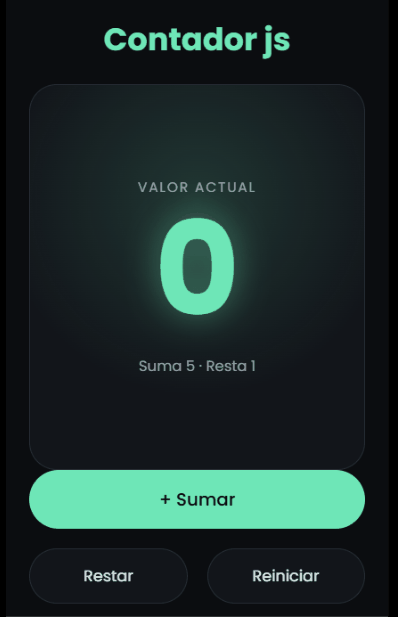

<div align="center">


### ✨ Un contador chiquito, hecho con mucho cariño ✨

Sube, baja y se reinicia con un clic, sin recargar la página 🎀


</div>

<div align="center">
  
</div>

## 🌟 ¿Qué hace?

| Botón            | Qué pasa                |
| ---------------- | ----------------------- |
| ➕ **Sumar**     | Suma 5 al valor actual  |
| ➖ **Restar**    | Resta 1 al valor actual |
| 🔄 **Reiniciar** | Vuelve a 0              |

🚫 Si restar dejaría el número en negativo, no lo permite y te avisa.

⚙️ Los valores de suma y resta están guardados en constantes, así que cambiarlos es editar una sola línea.

## 🛠️ Tecnologías

- 🧱 **HTML:** estructura de la página
- 🎨 **CSS:** estilos y diseño adaptable a móvil
- ⚡ **JavaScript:** selección de elementos, eventos de clic y actualización del DOM

## 🚀 Cómo ejecutarlo

1. Clona el repositorio:
   ```bash
   git clone https://github.com/Michael-SCS/contador-js.git
   ```
2. Entra a la carpeta:
   ```bash
   cd contador-js
   ```
3. Abre `index.html` en tu navegador 🎉

<details>
<summary>📁 Estructura del proyecto</summary>

```
contador-js/
├── index.html
├── styles.css
├── script.js
└── README.md
```

</details>

## 💡 Lo que aprendí

- 🔎 [Diferencia entre guardar un elemento en una variable y ejecutar una función]
- 🖱️ [Cómo escuchar eventos con addEventListener]
- 🐛 [Qué error me costó más y cómo lo resolví]

## 👩‍💻 Autor

<div align="center">

**Michael Castillo**

[](https://github.com/Michael-SCS)
[](https://www.linkedin.com/in/mscastillosaldarriaga/)
[](mailto:michaelsteven3211@gmail.com)

Hecho con 💜 y mucho café frío

</div>
